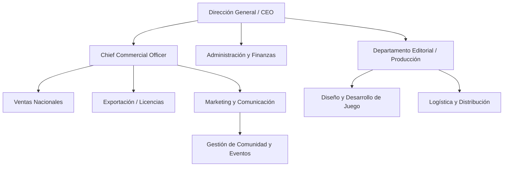

# 01 · Análisis y documentación inicial (RA1)

> **Plantilla.** Se entrega como **H1 el 26-nov-2026**. Cada apartado indica el criterio de evaluación (CE) que evidencia y qué se espera. Borra las notas en cursiva al rellenar.

## 1. Sector y empresas (CE 1a, 1b)

| Empresa | Características organizativas | Productos y servicios |
|---|---|---|
| **Asmodee** | Multinacional editorial y distribuidora, con diferentes estudios de desarrollo. | Juegos como *Dobble*, *Exploding Kittens* y *Star Wars: Unlimited*. |
| **Hasbro** | Gran empresa multinacional con diferentes divisiones de negocio. | Juegos de cartas como *Magic: The Gathering*. |
| **The Pokémon Company** | Empresa internacional que gestiona una franquicia mediante licencias y colaboraciones. | Juego de cartas coleccionables Pokémon, productos y eventos competitivos. |
| **Mattel** | Multinacional dedicada al diseño, fabricación y comercialización de juguetes y juegos. | Juegos de cartas como *UNO* y sus distintas versiones. |
| **Bandai Namco** | Grupo internacional con divisiones especializadas en entretenimiento y juegos de cartas. | *One Piece Card Game*, *Digimon Card Game* y *Dragon Ball Super Card Game*. |
| **Naipes Heraclio Fournier** | Empresa especializada en fabricación de naipes y productos tradicionales. | Barajas españolas, póker y cartas personalizadas. |

Asmodee es una empresa internacional dedicada a publicar y distribuir juegos de mesa y de cartas. Trabaja con estudios propios y colaboradores externos, comercializando sus productos en numerosos países.

Organigrama

## 2. Necesidades y oportunidades (CE 1c, 1d)

### Lista priorizada de necesidades demandadas

**Criterio de priorización:** Frecuencia de demanda en el canal especializado (tiendas y comunidades de juego) y su impacto directo en la decisión de compra y fidelización, según estudios sectoriales y análisis de tendencias.

| Prioridad | Necesidad | Justificación / Fuente |
| :--- | :--- | :--- |
| **1** | **Juego organizado y eventos competitivos** (torneos, ligas) | Es el motor de rotación de los TCG. Los espacios especializados lo identifican como servicio esencial para atraer y retener jugadores. |
| **2** | **Disponibilidad y acceso a stock** (producto sellado y cartas individuales) | La alta demanda provoca desabastecimiento en picos de lanzamiento, lo que genera frustración y pérdida de ventas. |
| **3** | **Comunidad y espacio físico para jugar** | El juego presencial es un factor clave de crecimiento; los jugadores buscan lugares donde socializar y desconectar de pantallas. |
| **4** | **Asesoramiento e iniciación** | La variedad de TCG y juegos de mesa requiere orientación para nuevos jugadores; las tiendas ofrecen soporte de iniciación como valor añadido. |
| **5** | **Contenido y herramientas digitales** (gestión de ligas, stock online) | La integración de tecnología en la experiencia del jugador (inscripciones, seguimiento de resultados) mejora la fidelización y la operativa del negocio. |

### Valoración de oportunidades de negocio (con datos cuantitativos)

1. **Crecimiento acelerado del mercado de TCG en España**
   - **Dato**: El mercado español de *Trading Card Games* (TCG) se valoró en **92,02 millones de USD en 2025** y se proyecta que alcance los **185,5 millones de USD en 2034**, con una **tasa de crecimiento anual compuesta (CAGR) del 8,1%** (2026-2034).
   - **Fuente**: Deep Market Insights (2026). *Spain Trading Card Game Market Size & Outlook*.

2. **Los juegos de cartas son la categoría de más rápido crecimiento en el sector juguetero español**
   - **Dato**: En 2025, la industria juguetera en España creció un 4%, pero la categoría de **juegos de cartas creció un 33%** respecto al año anterior, impulsada por el coleccionismo y el público *kidult*.
   - **Fuente**: Fournier, citando datos de Circana (2026). *2025, un año récord para los juegos de cartas*.

3. **El mercado global de TCG y el impulso del coleccionismo**
   - **Dato**: El mercado mundial de juegos de cartas coleccionables se estima en **9.200 millones de USD para 2026**, con previsión de alcanzar los **16.900 millones en 2035**. A nivel nacional, el mercado de juegos de mesa impulsado por los TCG ya supera los **140 millones de euros**, con un crecimiento anual cercano al **7%**.
   - **Fuente**: Deep Market Insights / Estimaciones del sector recogidas en *Jugamos Todos* (2026).

4. **Alta rotación y facturación local concentrada en torneos**
   - **Dato**: En zonas como Cartagena, los juegos de cartas (Magic, Pokémon, Dragon Ball) mueven una facturación estimada de **más de 1 millón de euros anuales** y congregan a unas **1.500 personas al mes** gracias a sus torneos.
   - **Fuente**: *La Verdad* (2026). *La moda de juegos de cartas... factura más de un millón de euros en Cartagena*.

## 3. Tipo de proyecto elegido (CE 1e)

*Qué proyecto das como respuesta y por qué, frente a otras alternativas.*

## 4. Requisitos y restricciones (CE 1f)

*Características que debe cumplir el proyecto, redactadas de forma **verificable** (no «debe ser rápido», sino «responde en menos de 2 s»). Parte de lo que has encontrado en [`01b-sota.md`](01b-sota.md).*

> **Guía.** Numera los requisitos **funcionales** como **RF-01, RF-02…** (qué hace el sistema) y los **no funcionales** como **RNF-01…** (cómo lo hace: rendimiento, seguridad, usabilidad, disponibilidad, accesibilidad). Las **restricciones** (plazo, presupuesto, tecnología obligatoria, normativa) como **REST-01…**. Cada requisito debe tener **una medida o una prueba**. Si aún no sabes cómo lo probarás, escribe «pendiente» y complétalo antes de H3.

| ID | Requisito | Tipo (funcional / no funcional / restricción) | Cómo se verifica |
|---|---|---|---|
| RF-01 | [RELLENAR] | funcional | |
| RNF-01 | [RELLENAR] | no funcional | |
| REST-01 | [RELLENAR] | restricción | |

### Matriz de trazabilidad

*Une cada objetivo con sus requisitos, y estos con lo que los implementa y los comprueba. Se rellena por completo al final del proyecto; en H1 basta con **objetivo y requisito**.*

> **Guía.** Ejemplo ficticio: *OBJ-01 Gestionar citas → RF-02 Crear una cita → CU-03 → `POST /citas` → prueba P-07.* Cada RF y cada RNF de la tabla anterior debe aparecer aquí.

| Objetivo | Requisito | Caso de uso | Pantalla o endpoint | Prueba o indicador |
|---|---|---|---|---|
| OBJ-01 [RELLENAR] | RF-01 | | | pendiente |

## 5. Obligaciones fiscales, laborales y de prevención (CE 1g)

*Las obligaciones que aplican a tu proyecto, **con su norma** y sus condiciones.*

## 6. Ayudas y subvenciones (CE 1h)

*Al menos **una** ayuda real: fuente, requisitos y plazo.*

## 7. Guion de trabajo (CE 1i)

*Fases, hitos y responsables del proyecto. Puede enlazar al tablero de GitHub Projects.*

## 8. Glosario

*Una cosa, un nombre: define los términos del dominio y de tu proyecto, y anota los sinónimos que **no** vas a usar en ningún documento. Con **5 términos** basta; crece con el proyecto.*

| Término | Definición | Sinónimos que NO uso |
|---|---|---|
| [RELLENAR] | | |

---

## Criterios de evaluación de este documento (RA1, texto literal)

- **1a)** Se han clasificado las empresas del sector por sus características organizativas y el tipo de producto o servicio que ofrecen.
- **1b)** Se han caracterizado las empresas tipo indicando la estructura organizativa y las funciones de cada departamento.
- **1c)** Se han identificado las necesidades más demandadas a las empresas.
- **1d)** Se han valorado las oportunidades de negocio previsibles en el sector.
- **1e)** Se ha identificado el tipo de proyecto requerido para dar respuesta a las demandas previstas.
- **1f)** Se han determinado las características específicas requeridas al proyecto.
- **1g)** Se han determinado las obligaciones fiscales, laborales y de prevención de riesgos y sus condiciones de aplicación.
- **1h)** Se han identificado posibles ayudas o subvenciones para la incorporación de nuevas tecnologías de producción o de servicio que se proponen.
- **1i)** Se ha elaborado el guión de trabajo que se va a seguir para la elaboración del proyecto.
